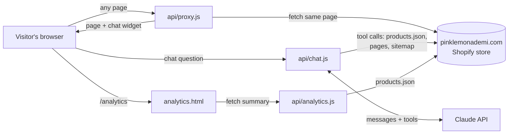

# Pink Lemonade AI Shop Assistant

An AI shopping assistant for [Pink Lemonade](https://pinklemonademi.com), a family-owned boutique with four stores in the Grand Rapids, Michigan area. Shoppers can ask questions like *"Do you have Jellycat bunnies under $30?"* or *"Is this dress in 4T?"* and get answers checked against the store's live inventory. A staff analytics page sits on top of the same data.

The project runs as a **staff preview**. It is a live, identical copy of the real website with the assistant added to every page, and anyone with the link can use it without signing in. Buying is turned off, so the team can try it safely before it goes on the real site.

| | |
|---|---|
| **Stack** | Node.js serverless functions on Vercel, plain HTML/CSS/JS front end, Claude API (Anthropic) with tool use, Chart.js |
| **Data source** | Shopify's public storefront endpoints (`/products.json`, page HTML, `/sitemap.xml`) |
| **Size** | About 750 lines of code, no build step, one dependency (`@anthropic-ai/sdk`) |

---

## Contents

1. [What it does](#what-it-does)
2. [How it works](#how-it-works)
3. [File map](#file-map)
4. [Run your own copy](#run-your-own-copy)
5. [Connecting her business tools](#connecting-her-business-tools)
6. [Making changes](#making-changes)
7. [Troubleshooting](#troubleshooting)
8. [How we built it](#how-we-built-it)
9. [Known limits](#known-limits)
10. [Ideas for what's next](#ideas-for-whats-next)

---

## What it does

**1. An identical copy of the store.** Every page, menu, photo and price matches pinklemonademi.com, because each page is fetched from the real site at the moment someone opens it. Nothing was copied by hand, so the copy never goes out of date.

**2. A chat assistant on every page.** A pink "Ask Pink Lemonade" button opens a chat that can:
- search all ~950 products by name, brand, type or tag, and filter by size in stock
- report which sizes of a product are in stock or sold out
- read any page on the site (shipping and return policies, contact, about) to answer store questions
- understand which page the shopper is on, so "is this in 4T?" works on a product page
- link straight to the products it mentions
- keep the conversation going as the shopper moves between pages

While it thinks, a pink lemon slice (from the store logo) spins next to rotating phrases like "Lemon-ing…" and "Looking up cute things…".

**3. A "Shop Insights" analytics page** (`/analytics`, linked in cursive at the top right of every page):
- **Live data:** product and brand counts, % of sizes in stock, median price, items on sale, new arrivals, biggest brands, brands selling out fastest, weekly new arrivals, price mix, and a "restock watch" table of items with sold-out sizes.
- **Sales & customers:** weekly sales (online vs. in store), new vs. returning customers, sales by location and top sellers. These show clearly labeled sample numbers until Shopify or Square is connected on the Connections tab, then switch to real ones.

The page has a second tab, **SEO & marketing** (`/analytics#seo`):
- **Search health (live):** checks every product page for a description, 2+ photos, photo alt text, a short title, tags and a product type, and scores the homepage basics (title, meta description, H1, share image, canonical link, structured data, local business info) with a tip for each fix.
- **Fix these first (live):** in-stock products with the most gaps, so the effort goes where it can sell.
- **Post ideas (live):** newest arrivals, items down to their last size, and items on sale, ready to share on Instagram and Facebook.
- **Traffic & social:** visit sources, Instagram and Facebook followers, newsletter open rates and top Google searches. These show sample numbers until Google, Instagram or Mailchimp is connected.

The third tab, **Connections** (`/analytics#connections`), has a **Connect** button for each business tool: Shopify, Square, Google Analytics & Search Console, Instagram & Facebook, and Mailchimp. Pressing one opens that service's own sign-in page, the owner approves read-only access, and the matching charts switch to real numbers. It's locked behind a staff passcode. See [Connecting her business tools](#connecting-her-business-tools).

**4. Safety rails.**
- Cart, checkout and account pages are blocked, and add-to-cart buttons show a "staff preview" notice.
- Search engines are told not to index the copy (`noindex` meta tag and `X-Robots-Tag` header), so it never competes with the real site on Google.
- The Anthropic API key stays on the server and is never sent to the browser.
- Each visitor is limited to 8 questions a minute, and conversation history is capped.
- Connecting services and seeing real sales numbers needs the staff passcode. Keys from connected services are encrypted (AES-256-GCM) before they're stored and are never sent to the browser.

---

## How it works



### The live mirror (`api/proxy.js`)

`vercel.json` sends every URL (except `/api/*`, `/pl-assistant/*` and `/analytics`) to the proxy function. For each request the proxy:

1. Fetches the same path from pinklemonademi.com.
2. Keeps redirects inside the copy.
3. For HTML pages, rewrites links to the real domain so they stay on the copy. Images and scripts still load from Shopify's CDN, and `/cdn/*` is redirected there.
4. Adds the `noindex` tag, the chat stylesheet and the chat script to every page. A version number tied to the deploy forces browsers to load fresh files after each update.
5. Returns a friendly "staff preview" page for blocked paths (cart, checkout, account).

### The assistant (`api/chat.js`)

The widget sends the conversation (last 10 turns) plus the current page path to `/api/chat`. The function runs a **tool-use loop** with Claude:

1. Claude gets a system prompt with store facts and answering rules ("check the live store, never guess, link products, keep it short and warm"), plus four tools:

   | Tool | What it does |
   |---|---|
   | `search_products` | Searches the full catalog (cached for 10 minutes). Optional size filter. Returns up to 10 matches with price and in-stock/sold-out sizes. |
   | `get_product` | Full details for one product: description, every size, stock status. |
   | `get_page` | Text of any site page, such as `/policies/refund-policy`. |
   | `list_site_pages` | Lists pages, policies and collections from the sitemap. |

2. If Claude asks for tools, the function runs them against the live store, sends back the results, and repeats (up to 6 rounds).
3. The final text answer goes back to the widget, which turns `[Product name](/products/handle)` into real links.

Model settings: `claude-opus-5-5` with `effort: "low"` (fast and inexpensive). The system prompt is marked for prompt caching to save cost on repeat questions.

**Stock data:** Shopify's public `products.json` gives each size an `available` flag, which reflects **online** availability. The assistant tells shoppers to contact the store for a specific location's shelves.

### The analytics page (`api/analytics.js` + `pl-assistant/analytics.html`)

`api/analytics.js` downloads the full catalog and computes a JSON summary (totals, top brands, sell-out rates, price bands, weekly arrivals, restock list). The result is cached on Vercel's edge for 10 minutes. The page draws it with Chart.js in a pink theme. `summarize()` is a pure function, so it's easy to test.

### The chat widget (`pl-assistant/widget.js` + `widget.css`)

This is plain JavaScript with no framework. It builds the chat bubble and panel, saves the conversation in `sessionStorage` so it survives page changes, places the Shop Insights link next to the header icons (or floats it top right if that spot isn't visible), and blocks buying actions. All widget styles are scoped under `#pla-root` and use `!important` where the store's theme would otherwise override them (the theme writes inputs in all caps, for example).

---

## File map

```
api/
  proxy.js          Live mirror of the store, adds the widget to every page
  chat.js           Claude tool-use loop + /api/chat?check=1 health check
  analytics.js      Catalog statistics for the analytics page
  seo.js            SEO audit, homepage checks and post ideas for the SEO & marketing tab
  connect.js        Connect buttons: sends the owner to each service's sign-in, saves the key it returns
  admin.js          Staff passcode, list of connected services, disconnect
  insights.js       Real sales, customers, traffic, social and email numbers from connected services
  _lib/             Shared code (not endpoints): providers.js (each service's sign-in steps),
                    auth.js (passcode, cookies, encryption), store.js (Upstash Redis storage)
pl-assistant/
  widget.js         Chat bubble, Shop Insights link, preview banner, buy-blocking
  widget.css        Widget styles (scoped, theme-proof)
  analytics.html    "Shop Insights" dashboard: Store & sales, SEO & marketing, Connections
vercel.json         Routing: everything → proxy; /analytics → dashboard; /connect/* → connect.js; noindex header
package.json        One dependency: @anthropic-ai/sdk
streamlit-version/  Earlier prototype (see "How we built it"); ignored by Vercel
```

---

## Run your own copy

You need a GitHub account, a free [Vercel](https://vercel.com) account and an [Anthropic API key](https://console.anthropic.com).

1. **Fork or clone** this repo into your GitHub account.
2. **Create an API key** at console.anthropic.com. Under *Limits*, set a monthly spend cap (for example $20) so costs can't run away.
3. **Import into Vercel:** at vercel.com/new, pick the repo. Leave *Framework* as "Other" and don't add any build settings.
4. **Add environment variables** (Project → Settings → Environment Variables):

   | Name | Value | Required |
   |---|---|---|
   | `ANTHROPIC_API_KEY` | your key (`sk-ant-…`); `ANTHROPIC_KEY` also works | yes |
   | `STORE_ORIGIN` | another Shopify store's URL, to point the project at that store | no (defaults to `https://pinklemonademi.com`) |

5. **Deploy.** Share the main `https://<project>.vercel.app` address.
6. **Check it:** open `https://<project>.vercel.app/api/chat?check=1`. You should see `"key_present": true`, `"claude": "ok: …"` and a product count.

Every push to `main` redeploys automatically in about a minute.

### Running locally

```bash
npm install
npm i -g vercel
vercel link          # connect to your Vercel project
vercel env pull      # download the API key into .env.local
vercel dev           # http://localhost:3000
```

### Cost

Each question costs roughly a few cents with Opus 5.5 at low effort, a bit more when Claude needs several lookups. To cut cost a lot (with somewhat simpler answers), change `model` in `api/chat.js` to `claude-haiku-5-5`. Vercel's free plan covers the hosting for this kind of traffic.

---

## Connecting her business tools

The Connections tab works like the "Sign in with Google" buttons on other sites (OAuth). Each service needs a one-time setup so it knows this site is allowed to ask. After that, connecting is one click and an "Allow" on the service's own page.

### One-time setup (do these first)

1. **Staff passcode.** In Vercel → Settings → Environment Variables, add `ADMIN_PASSCODE` with a strong passcode. Only people who know it can connect services or see real sales numbers. Optionally add `APP_SECRET` (any long random string). It's used to encrypt stored keys, and if it's missing the passcode is used instead, so changing the passcode later disconnects everything.
2. **Storage.** In Vercel → Storage, add **Upstash for Redis** (free tier) and connect it to this project. That adds `KV_REST_API_URL` and `KV_REST_API_TOKEN` automatically.
3. **Site address.** Add `PUBLIC_URL` with the site's main address, for example `https://pink-lemonade-assistant.vercel.app`. Each service checks that sign-ins return to exactly this address.
4. **Redeploy** so the new variables take effect.

### Each service

For each one, create a free "app" in the service's developer site, set its **redirect / callback URL** to `PUBLIC_URL` + `/connect/<id>/callback`, and copy its ID and secret into Vercel. The Connections tab shows the exact callback address for each service, and marks a service "Setup needed" until its variables exist.

| Service | `<id>` | Where to create the app | Vercel variables | Access requested (read-only) |
|---|---|---|---|---|
| Shopify | `shopify` | Shopify's developer dashboard / Partners (create an app, distribute it to her store only) | `SHOPIFY_CLIENT_ID`, `SHOPIFY_CLIENT_SECRET` | `read_orders`, `read_customers`, `read_products`, `read_inventory`, `read_locations` |
| Square | `square` | developer.squareup.com → Applications → OAuth | `SQUARE_CLIENT_ID`, `SQUARE_CLIENT_SECRET` (`SQUARE_ENVIRONMENT=sandbox` to test) | orders, payments, customers, items, inventory, merchant profile |
| Google Analytics & Search Console | `google` | console.cloud.google.com → APIs & Services: enable the *Google Analytics Data API*, *Google Analytics Admin API* and *Search Console API*, set up the OAuth consent screen, then create an OAuth client (Web application) | `GOOGLE_CLIENT_ID`, `GOOGLE_CLIENT_SECRET` (optional `GA4_PROPERTY_ID`) | `analytics.readonly`, `webmasters.readonly` |
| Instagram & Facebook | `meta` | developers.facebook.com → My Apps → create a Business app with Facebook Login | `META_APP_ID`, `META_APP_SECRET` (optional `META_GRAPH_VERSION`, default `v23.0`) | `pages_show_list`, `pages_read_engagement`, `instagram_basic`, `instagram_manage_insights` |
| Mailchimp | `mailchimp` | Mailchimp → Account → Extras → Registered apps | `MAILCHIMP_CLIENT_ID`, `MAILCHIMP_CLIENT_SECRET` | campaign reports and list size |

Notes:
- **Shopify:** when connecting, type the store's `something.myshopify.com` address (find it in Shopify admin → Settings → Domains). Shopify shares the **last 60 days** of orders by default, which is why sales charts cover 8 weeks. Set `SHOPIFY_API_VERSION` if the default (`2026-07`) is ever retired.
- **Instagram:** the Instagram account must be a Business or Creator account linked to a Facebook Page. Meta's 60-day key has to be reconnected about every two months.
- **Google:** while the Google app is in "Testing" mode, add her Google account as a test user.
- Real numbers are cached for 15 minutes. Connecting or disconnecting clears the cache.
- These developer dashboards change often. If a menu name above doesn't match, search the service's docs for "OAuth app" or "redirect URL".

### Adding another service

Copy an entry in `api/_lib/providers.js` (its sign-in link, how to swap the returned code for a key, and optionally how to refresh the key), then add a fetcher in `api/insights.js` and a chart in `analytics.html`. Good candidates are Klaviyo, Google Business Profile (reviews), Lightspeed or Clover (if a store uses them) and QuickBooks.

---

## Making changes

| To change… | Edit |
|---|---|
| What the assistant knows or how it talks | `SYSTEM` prompt at the top of `api/chat.js` |
| Add a new ability (for example store hours lookup) | Add an entry to the `tools` array in `api/chat.js` with `name`, `description`, `input_schema` and a `run()` function |
| Suggestion chips or "thinking" phrases | `SUGG` and `THINKING` arrays in `pl-assistant/widget.js` |
| Colors and layout of the chat | `pl-assistant/widget.css` (colors are variables at the top) |
| Charts on the analytics page | `summarize()` in `api/analytics.js` for the data, `pl-assistant/analytics.html` for the charts |
| Which pages are blocked | `BLOCKED` regex in `api/proxy.js` |

---

## Troubleshooting

| Symptom | Cause and fix |
|---|---|
| Chat says "Sorry, I can't answer right now" | Open `/api/chat?check=1`. If `key_present` is `false`, the key variable is missing or misnamed; add it and **redeploy** (Vercel only applies variables to new deploys). If `claude` shows an error, the key is wrong or the account is out of credit. |
| A change doesn't show up | Check `deployed_commit` on the health check page against the latest commit on GitHub. Make sure you're on the main address, not a deploy-specific link with a random code in it. Hard refresh (Ctrl+Shift+R). |
| New pushes stop going live | You probably redeployed or "rolled back" to an older deploy, which pauses auto-updates. In Vercel → Deployments, open the newest one → ⋯ → **Promote**. |
| Build fails with "No python entrypoint found" | Vercel saw a Python file at the root. Keep Python files inside `streamlit-version/` (it's in `.vercelignore`) and keep `"framework": null` in `vercel.json`. |
| Text in the chat shows in capitals | The store theme's CSS is winning. Add the property with `!important` under `#pla-root` in `widget.css`. |

---

## How we built it

This was built over a couple of days by iterating with Claude (Anthropic's AI) as a coding partner. The git history tells the story commit by commit.

1. **Prototype as a Claude artifact.** The first version was a single web page with a snapshot of ~95 products and a chat. It proved the idea, but opening it required a Claude account, and store workers don't have one.
2. **Streamlit version** (`streamlit-version/`). Streamlit Cloud hosted it with a public link, but the chat could only sit beside a static mock-up of the store. It didn't look or feel like the real site, which made it harder for staff to picture.
3. **Switch to a live mirror on Vercel.** To make it *identical*, we stopped copying the site and started proxying it. Each page is fetched live and the widget is added on top. The assistant moved from a product snapshot to **tools** that read the live catalog, so stock and prices are always current.
4. **Deployment fixes.** Vercel first tried to build the Python files, so we moved them into a subfolder. Then the chat failed because the API key wasn't reaching the function, so we added the `/api/chat?check=1` health check, which showed the variable was named `ANTHROPIC_KEY`. The code now accepts both names.
5. **Polish from real use:** stopping the theme from forcing caps in the chat, adding the analytics dashboard, placing the Shop Insights link in the header, the spinning pink lemon, and the playful thinking phrases.

**Key design decisions**

- **Proxy instead of copy.** Copying ~950 products and every page by hand would go stale immediately. A proxy is always current and is about 60 lines of code.
- **Tools instead of stuffing the catalog into the prompt.** The full catalog is far too big for a prompt. With tools, Claude searches and fetches only what it needs, and every answer is grounded in live data.
- **No framework.** Plain HTML/JS keeps the widget small and safe to inject into someone else's page, and leaves no build step to break.
- **Clearly labeled sample data.** Sales and customer data isn't public, so the dashboard shows the *design* with sample numbers flagged as samples, rather than presenting made-up figures as real.

---

## Known limits

- **Online stock only.** Public Shopify data shows whether a size is available online, not how many units, and not which of the four stores has it.
- **Sales and customer charts are samples until a service is connected.** Connecting needs the one-time developer-app setup above. The Connect flows were tested end to end against mock services, but not yet against the real Shopify, Square, Google, Meta or Mailchimp servers, so expect small fixes the first time each one is connected.
- **New vs. returning customers** comes from Shopify only (Square orders don't say). "Returning" means the customer has more than one order on record.
- **Rate limiting is per server instance.** It's a best-effort limit; the real safety net is the spend cap on the Anthropic account.
- **Depends on the live site.** If pinklemonademi.com changes its theme drastically, the header-link placement falls back to a floating button, but other tweaks may be needed.
- **No automated tests yet.** `summarize()`, `audit()`, `homepageChecks()`, `rewriteHtml()` and the chat `tools` are exported specifically so they can be unit tested.

---

## Ideas for what's next

These are good next steps for an internship project, roughly from most to least valuable:

1. **Go live with the Connect buttons.** Do the one-time setup above for Shopify first, then Google. The code is written and tested with mock services, and connecting the real accounts is the first milestone. After that, extend the dashboards: year-over-year comparisons (Shopify's `read_all_orders` access gives more than 60 days), conversion rate from Google Analytics, and which Instagram posts drive website visits.
2. **More SEO checks.** The SEO tab's live audit (`api/seo.js`) is a good place to add broken-link checks, page speed (Google's PageSpeed Insights API), and Search Console "pages not indexed" reports now that Google can be connected.
3. **Per-store inventory.** The Shopify connection already asks for `read_inventory` and `read_locations`. Add a `check_store_stock` tool to `api/chat.js` so the assistant can answer "Is this at the Grand Rapids store?"
4. **Question log and insights.** Save anonymized questions (for example in Vercel KV or a Google Sheet) to learn what shoppers ask for that the store doesn't carry. This would make a strong data-analysis piece.
5. **Daily restock email** to the owner listing sold-out and low-stock items, using a Vercel Cron Job.
6. **Evaluation and tests.** Build a set of 30–50 realistic questions with expected answers and score the assistant automatically. Add unit tests for the exported functions.
7. **Ship it on the real site.** Package the widget as a Shopify theme app extension (app embed) so it runs on pinklemonademi.com itself, with cart actions turned back on.
8. **Accessibility and multilingual support:** keyboard and screen-reader testing for the widget, and answering in the shopper's language.

---

*Built for Pink Lemonade by Michael with Claude. Store content and branding belong to Pink Lemonade.*
